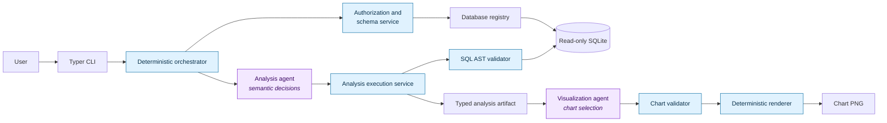

# AgentViz

**A security-first, multi-agent data analysis CLI that turns natural-language
questions into validated SQL, reproducible results, and trustworthy charts.**

AgentViz explores a practical question: how can an LLM make useful analytical
decisions without giving it direct control of a database or chart renderer? The
answer is a deliberately small agent surface wrapped in deterministic Python
guardrails.

## At a glance

| | |
| --- | --- |
| **Agent boundaries** | Separate analysis and visualization agents with typed Pydantic outputs |
| **Security** | Database ACLs, read-only SQLite connections, SQL AST validation, row limits, and timeouts |
| **Explainability** | Optional SQL display, structured workflow events, and inspectable LLM I/O traces |
| **Reproducibility** | Every full run writes a manifest containing the request, SQL, result metadata, and chart path |
| **Quality** | 256 automated tests covering unit, integration, end-to-end, adversarial, and agent scenarios |
| **Stack** | Python 3.12, OpenAI API, Pydantic, SQLAlchemy, SQLGlot, Typer, and Matplotlib |

## Architecture



The agents propose intent; they do not receive database connections or rendering
capabilities. Authorization, query execution, validation, resource limits, and
file creation remain deterministic and independently testable.

### Request flow

1. Resolve the configured user and enforce database-level access policy.
2. Expose only the authorized database schema to the analysis agent.
3. Ask the analysis agent for a typed query, clarification, or unsupported result.
4. Parse the proposed SQL into an AST, allow one `SELECT`, and reject unsafe
   operations or unsupported table references.
5. Execute through a read-only adapter with configurable row and time limits.
6. Give the visualization agent a row-free column profile, then validate its
   typed chart specification against the real result.
7. Render with deterministic styling and write a row-free run manifest.

## Quick start

### Requirements

- Python 3.12+
- An OpenAI API key for LLM-backed analysis

Install the package in editable mode:

```bash
git clone https://github.com/mflodzinski/agentviz.git
cd agentviz
python3 -m venv .venv
source .venv/bin/activate
python -m pip install -e ".[dev]"
export OPENAI_API_KEY="your-api-key"
```

The repository includes three sample SQLite databases and configuration for the
user `bob`. Start by checking what that user may access:

```bash
agentviz databases --user bob
agentviz schema --user bob --db chinook
```

Run the complete analysis and visualization workflow:

```bash
agentviz ask \
  "Show revenue by billing country" \
  --user bob \
  --db chinook \
  --show-sql \
  --verbose
```

AgentViz writes generated output beneath `runs/<run_id>/`:

```text
runs/<run_id>/
├── chart.png
└── manifest.json
```

Add `--save-llm-io` to record the exact prompts, response schemas, and structured
model outputs in `llm_io.json`. These traces are opt-in because they may contain
the user's request and schema metadata.

For an analysis without chart selection or rendering:

```bash
agentviz analyze \
  "What is the total revenue?" \
  --user bob \
  --db chinook
```

## Safety model

LLM output is treated as untrusted input. AgentViz uses layered controls rather
than relying on a system prompt as a security boundary.

| Control | What it protects |
| --- | --- |
| Request guard | Rejects obvious destructive and instruction-overriding intent before an agent call |
| Database ACL | Prevents a configured user from inspecting or querying denied databases |
| Typed contracts | Reject malformed analysis plans, artifacts, and chart specifications |
| SQLGlot validation | Requires exactly one read-only `SELECT` and blocks unsafe statements, functions, system tables, and cross-database references |
| Table validation | Ensures every referenced table belongs to the authorized schema |
| Read-only adapter | Opens SQLite with `mode=ro` and enables `PRAGMA query_only` as a second line of defense |
| Resource limits | Caps returned rows and interrupts long-running SQLite queries |
| Chart validation | Rejects missing columns, incompatible types, excessive categories, null-heavy inputs, and misleading charts over truncated data |
| Data minimization | Sends the visualization agent column profiles rather than raw result rows |

## Key design decisions

### Two focused agents, deterministic orchestration

Analysis and visualization require different context and make different semantic
choices, so they are separate. A conventional orchestrator owns sequencing and
failure handling; an agent is never asked to decide whether a safety check runs.

### Typed outputs at every model boundary

Pydantic models turn free-form model responses into explicit contracts. This
makes invalid output fail closed and lets the same workflows run against real,
fake, or deterministic demo planners in tests.

### Defense in depth for generated SQL

SQL is checked structurally before it reaches the database, and the database
connection itself is read-only. Either control can catch a failure in the other,
while row and time limits bound otherwise valid but expensive queries.

### Visualization is a recommendation, not code generation

The visualization agent selects a typed `ChartSpec`; it never writes Python.
Compatibility checks and Matplotlib rendering stay deterministic, which avoids
executing model-generated code and keeps styling consistent.

## Configuration

Databases and query limits live in `config/databases.yaml`:

```yaml
databases:
  chinook:
    backend: sqlite
    path: data/chinook.db

query:
  max_rows: 5000
  timeout_seconds: 10

llm:
  provider: openai
  model: gpt-5
  visualization_model: gpt-5-nano
  api_key_env: OPENAI_API_KEY
  temperature: 0
```

User restrictions live separately in `config/users.yaml`:

```yaml
users:
  bob:
    denied_databases:
      - sakila
      - northwind
```

Set `AGENTVIZ_CONFIG_DIR` to load both files from another directory. API keys are
resolved from the configured environment variable and are never stored in YAML.

### Adding a database

The current implementation supports SQLite. To register another SQLite database:

1. Place the database file outside version control when it contains private data.
2. Add its logical name, `backend`, and `path` to `config/databases.yaml`.
3. Add any per-user denial rules to `config/users.yaml`.
4. Confirm access with `agentviz databases` and `agentviz schema`.

The `DatabaseAdapter` protocol and `DatabaseRegistry` isolate backend-specific
behavior. Adding PostgreSQL, for example, would require a new adapter and registry
factory branch, without changing either agent contract.

## Testing

Run the full suite and linter:

```bash
pytest
ruff check .
```

The test suite includes:

- focused unit tests for policies, validators, models, rendering, and adapters;
- integration tests for analysis execution and orchestration;
- end-to-end CLI and workflow tests;
- adversarial SQL, prompt-injection, authorization, and failure-path cases;
- recorded/fake LLM scenarios for query planning, repair, clarification, and
  malformed structured output.

## Repository map

```text
src/agentviz/
├── agents/          # Analysis and visualization agent boundaries/planners
├── analysis/        # Request safety, execution service, and summaries
├── auth/            # Identity resolution and database ACL policy
├── database/        # Adapter protocol, registry, and read-only SQLite adapter
├── llm/             # Provider client, structured output, and opt-in tracing
├── models/          # Typed cross-layer contracts
├── sql/             # SQL AST validation and bounded execution
├── visualization/   # Context profiling, chart validation, and rendering
├── cli.py
└── orchestrator.py
```

More detail is available in the
[project specification](docs/PROJECT_SPEC.md),
[implementation plan](docs/IMPLEMENTATION_PLAN.md), and
[dataset notes](docs/DATASET_NOTES.md).

## Current limitations

- SQLite is the only implemented backend.
- Authorization is configuration-based database ACL, not application-level
  authentication or row/column-level security.
- The request guard catches known high-risk patterns; it is not a general prompt-
  injection detector. Deterministic downstream controls remain authoritative.
- Run manifests intentionally omit result rows, so they support auditing and
  re-render context rather than full query-result replay.
- There is no web UI, distributed execution, or write-query support; these are
  deliberate non-goals for this take-home-sized system.
